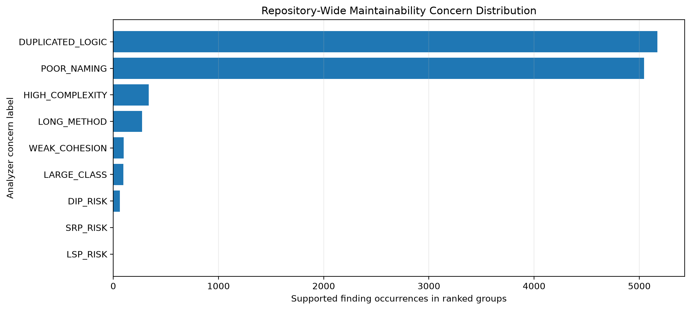
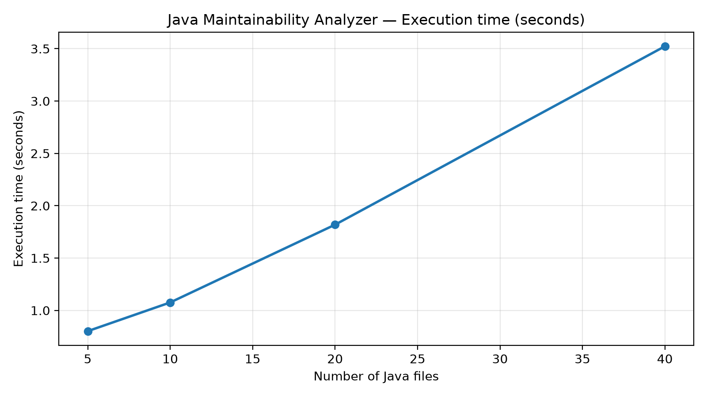
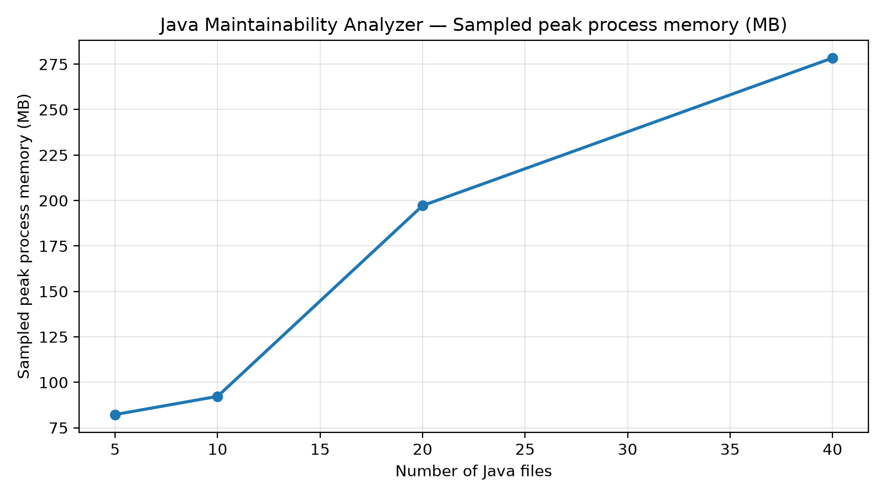
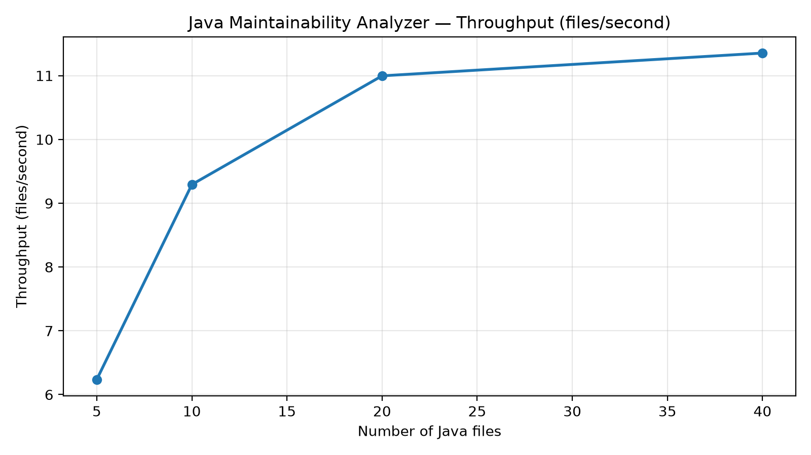
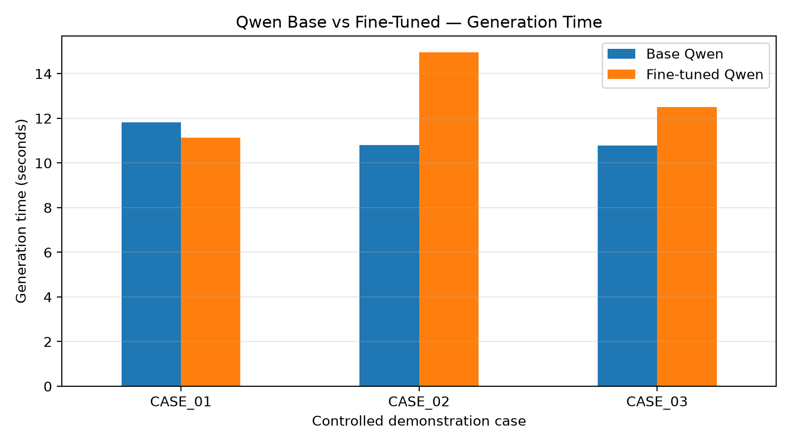

# J26-SE-361 — Code Cleanliness & Maintainability
## Maintainability Triage — Evaluation Summary

### 1. Research Component

The component implements repository-wide Java maintainability analysis,
related issue grouping, evidence-aware priority ranking, and AI-assisted
maintainability explanations.

The implemented pipeline is:

Java Repository → Parsing and Cross-File Analysis → Maintainability Detection
→ Related Issue Grouping → Priority Ranking → Qwen Explanation.

The project uses a VS Code extension as its user-facing interface.

### 2. Implementation Verification

- Java automated tests: 152 passed, zero failures.
- VS Code TypeScript compilation and linting: passed.
- End-to-end extension demonstration: passed.
- Demonstration repository: 5 Java files parsed, 0 failures.
- Detected findings: 6.
- Related issue groups: 2.
- Fine-tuned Qwen explanation successfully displayed in VS Code.

These results establish implementation functionality, not independent
real-world detection accuracy.

### 3. Complete Maintainability Coverage

The analyzer implements 12 maintainability concerns.

In the recorded repository analysis, 9 concern labels occurred:

| Concern | Finding occurrences |
|---|---:|
| Duplicated Logic | 5173 |
| Poor Naming | 5044 |
| High Complexity | 338 |
| Long Method | 273 |
| Weak Cohesion | 99 |
| Large Class | 97 |
| DIP Risk | 62 |
| SRP Risk | 3 |
| LSP Risk | 1 |

Total finding occurrences: 11090.
Ranked issue groups: 4461.

These values describe analyzer output on the selected source batch.
They are not confirmed true-positive counts. The large Duplicated Logic
and Poor Naming counts may reflect noise, repeated occurrences or
characteristics of generated source files.

### 4. External Detection Evaluation — MLCQ

The selected MLCQ evaluation includes 72 scored samples:
36 Long Method and 36 Blob examples.

| Concern | System | Precision | Recall | F1 |
|---|---|---:|---:|---:|
| Long Method | Analyzer | 1.000 | 0.471 | 0.640 |
| Long Method | PMD proxy | 1.000 | 0.118 | 0.211 |
| Blob/God Class | Analyzer | Undefined | 0.000 | 0.000 |
| Blob | PMD proxy | 1.000 | 0.529 | 0.692 |

Eight prepared samples were excluded from scoring.

The analyzer demonstrated higher measured Long Method recall than the
PMD proxy in this selected sample. Conversely, the strict God Class
matching approach did not identify the annotated Blob positives.

These comparisons are preliminary because of sample selection,
different rule definitions, proxy matching, and source-matching
limitations. The two evaluated smells do not represent the accuracy
of all 12 implemented concerns.

### 5. Issue Grouping

A review template containing 160 candidate finding pairs was prepared.

Independent pair labels have not yet been collected. Pairwise
precision, recall, and F1 therefore remain unreported.

### 6. Priority Ranking

A review template containing 40 ranked groups was prepared.

Independent reference priority judgments remain outstanding.
Spearman correlation and Top-k agreement are not yet established.

Priority scores remain provisional and should not be interpreted
as independently calibrated maintenance cost.

### 7. Java Analyzer Scalability

Preliminary single-run measurements:

| Java files | Runtime (s) | Peak sampled process memory (MB) | Files/s |
|---:|---:|---:|---:|
| 5 | 0.802 | 82.25 | 6.236 |
| 10 | 1.076 | 92.26 | 9.293 |
| 20 | 1.819 | 197.18 | 10.997 |
| 40 | 3.523 | 278.41 | 11.354 |

These measurements use selected source files. Sampled working-set
memory is not equivalent to exact peak JVM heap memory. Further
repeated experiments on larger, representative Java repositories
are required.

### 8. Qwen Base vs Fine-Tuned Comparison

Qwen2.5-Coder-7B-Instruct was adapted using QLoRA for
maintainability explanation.

Three controlled demonstration cases were evaluated with both
the base model and the trained LoRA adapter, yielding six responses.

The trained model showed evidence-conscious behavior in some examples,
including acknowledgment of missing supporting information. The base
model sometimes produced more detailed explanations but also
introduced unsupported specifics.

Generation time was measured directly. The experiment is not
sufficient to establish that fine-tuning improves overall explanation
quality. Independent scoring of correctness, relevance,
actionability, grounding, and unsupported claims remains necessary.

### 9. Research Contribution

The implemented contribution is an integrated maintainability triage
workflow combining:

1. Repository-wide Java maintainability analysis.
2. Detection of multiple maintainability concern types.
3. Grouping of related maintainability findings.
4. Evidence-aware priority ordering.
5. Fine-tuned language-model explanations within a VS Code extension.

The integration has been demonstrated successfully. Research claims
about improvement over alternatives require further independent
validation, especially for grouping, ranking and explanation quality.

### 10. Remaining Research Validation

- Independently review grouping candidates and calculate pairwise metrics.
- Independently assess ranked groups and calculate ranking agreement.
- Review base and fine-tuned model explanations using a documented rubric.
- Extend external detection validation to additional concern categories.
- Repeat scalability benchmarks on larger representative repositories.
- Investigate high-volume detection categories and calibrate thresholds.

### 11. Reproducible Evidence

Primary notebook:

`notebooks/29f_reproducible_evaluation.ipynb`

Experiment data and generated figures:

`results/final_evaluation/`

Qwen training notebook:

`../llm/notebooks/qwen_qlora_29f_training_evaluation.ipynb`

All quantitative claims above should be interpreted in their stated
experimental scope.
